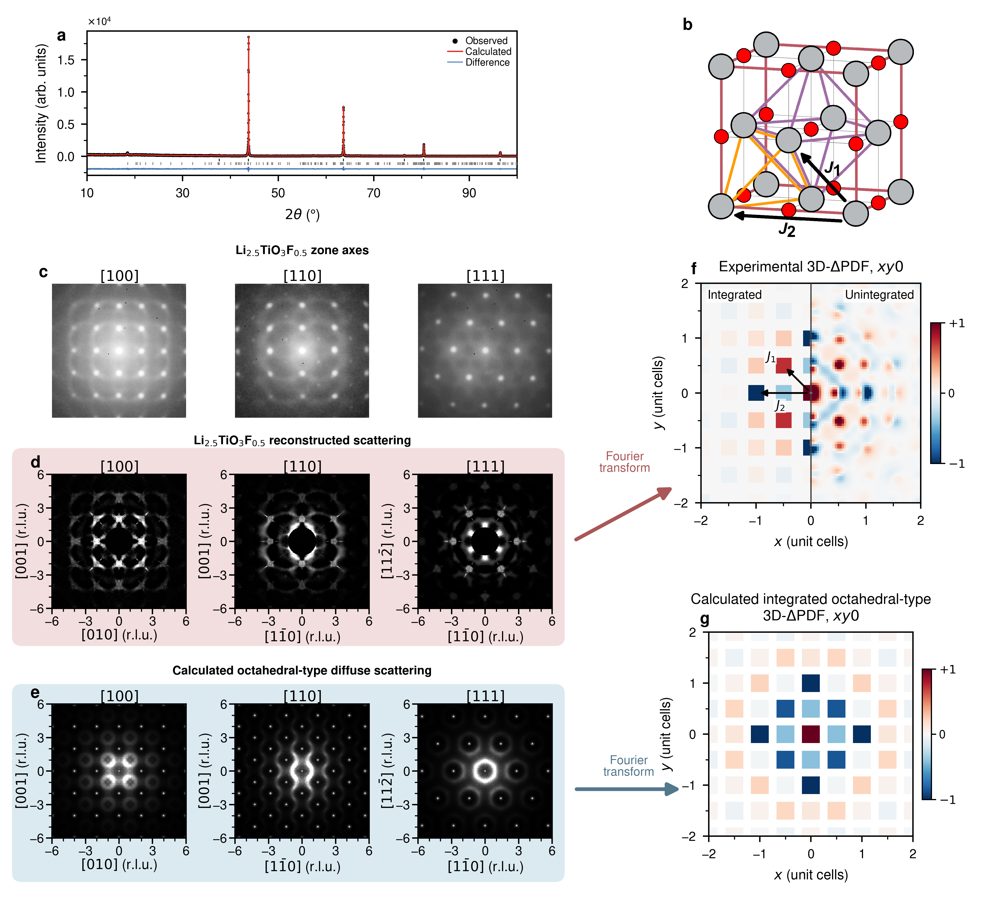
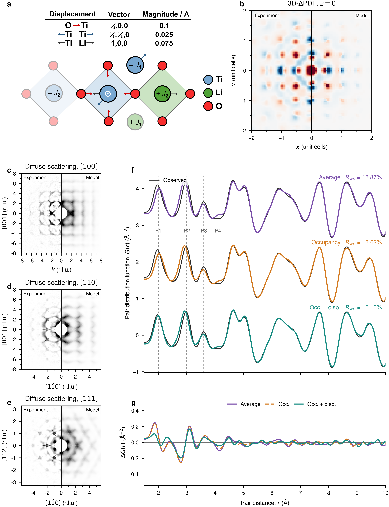
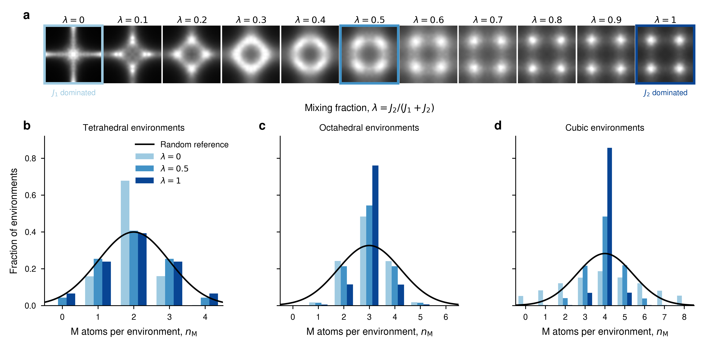
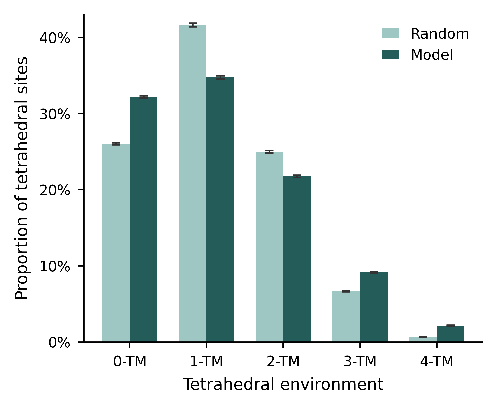

# Article figures

Each figure folder contains one standalone `plot.py` and a `data/` directory with its plotting inputs and supporting crystal structures.

| Figure | Plotting script | Input data |
| --- | --- | --- |
| 1 — Experimental overview | [plot.py](figure_1/plot.py) | [data/](figure_1/data/) |
| 2 — Model, scattering and PDF comparisons | [plot.py](figure_2/plot.py) | [data/](figure_2/data/) |
| 3 — Interaction mixing sweep (neutron scattering) | [plot.py](figure_3/plot.py) | [data/](figure_3/data/) |
| 4 — 0-TM ensemble populations | [plot.py](figure_4/plot.py) | [data/](figure_4/data/) |

## Reproduce

Use Python 3.10 or later and install the plotting dependencies:

```bash
python -m pip install -r figures/requirements.txt
python figures/figure_1/plot.py
python figures/figure_2/plot.py
python figures/figure_3/plot.py
python figures/figure_4/plot.py
```

Each script resolves data relative to its own location and writes PNG (600 dpi), PDF, and SVG files into that figure's `output/` directory. The reference PNGs below are the article figures.

## Figure 1



PXRD refinement and structure schematic; [100], [110], and [111] zone-axis, reconstructed, and calculated scattering; experimental and calculated integrated 3D-ΔPDFs.

The data folder includes the refinement CSV and phase tick lists, structure and diffraction images, experimental scattering HDF5, integrated and unintegrated experimental xy0 arrays, calculated scattering planes, and the Run-80 integrated ΔPDF lattice volume and direct-space axis. Calculated-plane scaling is retained from the plane data; the integrated model ΔPDF color scale excludes the origin.

## Figure 2



Model schematic, experimental/model 3D-ΔPDF and diffuse-scattering half-plane comparisons, and three PDF fits with residuals.

The data folder includes the schematic, three PDF fit tables, experimental ΔPDF and scattering HDF5 files, the model ΔPDF volume and direct axis, and model scattering values. Model arrays are stored losslessly as compressed NumPy archives: `volume` for the ΔPDF, and `h`, `k`, `l`, `intensity` for scattering. All input values and precision are retained.

## Figure 3



Eleven calculated coherent nuclear neutron diffuse-scattering surfaces at λ = 0, 0.1, …, 1, with local-environment distributions at λ = 0, 0.5, 1. The MC models use J1 + J2 = 2.32 eV at 1000 K. The Q-independent neutron scattering lengths show the occupational correlations without atomic form-factor attenuation.

Scatty (version dated 14 October 2022) uses `RADIATION N`, the tabulated scattering lengths for the original Li, Fe, and O species, cubic `m3m` Laue symmetry, and F-centring Bragg removal. Each scattering average uses 99 configurations sampled from a single seeded MC trajectory. The `(0kl)` section covers 0 ≤ k,l ≤ 2 in steps of 0.02 r.l.u. (101 × 101 points).

The data folder contains `scattering_lambda_*.txt`, `local_environment_counts.csv`, all eleven `structure_lambda_*.cif` crystal structures, and `scatty_config.txt`. The CIFs are the exact final snapshot 99 files identified by the local-environment analysis. All data belong to the 0.20 eV sweep. Numbers in the `lambda_*` filenames denote the mixing fraction λ = J2/(J1 + J2).

The `mc_lambda_*.npz` files retain the complete sampled occupational configurations: one bit per cation (`1=Fe`, `0=Li`, `bitorder="little"`), with `n_cations`, sampling steps, seed, interactions, and temperature recorded. Unpack each row of `occupations` and trim it to `n_cations`. Rows 0–99 correspond to MC steps `1000001 + 10101*i`; Scatty reads input files 01–99, so rows 1–99 enter the scattering average.

Each scattering panel is independently normalized at its 99.5th percentile. The local-environment distributions are unchanged; their black reference curves use a normal approximation to the fixed-composition random fractions in the CSV. The input species is Fe and the figure labels it M.

## Figure 4



Tetrahedral-site populations for 100 model configurations and 100 random controls. The input is `ensemble_summary.csv`. Bars show means of `tm0_fraction` through `tm4_fraction`; error bars show sample standard deviations across configurations.

The data folder also retains all 200 crystal structures: `model_configurations.extxyz.gz` contains the 100 model configurations and `random_configurations.extxyz.gz` contains the 100 random controls. Each frame includes its configuration index, seed, atomic species, positions, and periodic cell (21 × 21 × 21 conventional cells; lattice constant 4.1 Å). These compressed extended-XYZ files can be opened directly with ASE. The model trajectory is a lossless compressed copy of the source file; random-control structures use the exact saved occupations on the same ideal rocksalt lattice.

`configurations_bitpacked.npz` preserves the original occupations and seeds for both ensembles. Arrays `mc` and `random` contain one bit per cation (`1=Ti`, `0=Li`), packed with `bitorder="little"`; trim each unpacked row to `n_cations`. The extended-XYZ files include the oxygen sites as well as the cations.
