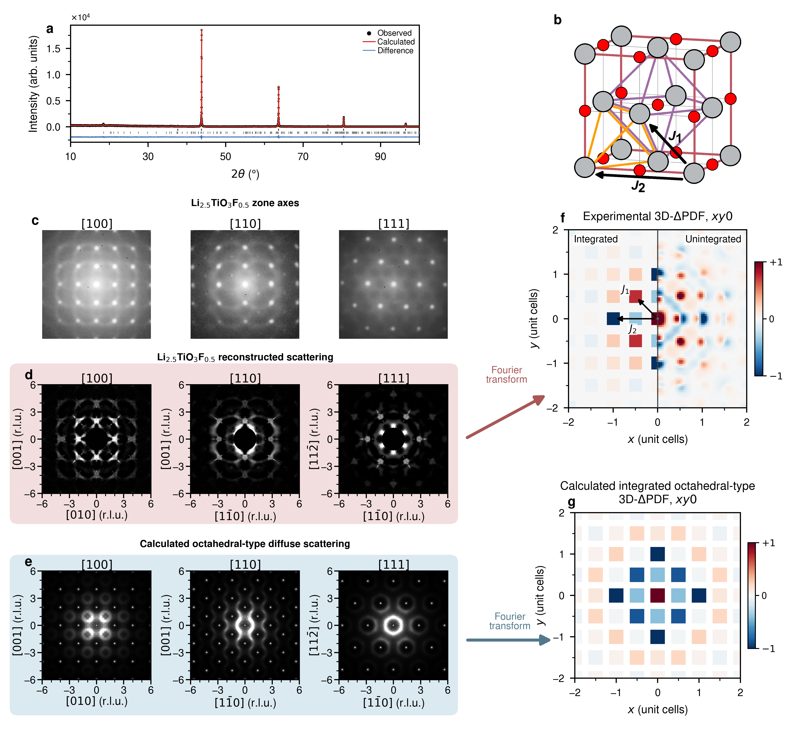

# Figure 1 — Experimental overview



PXRD refinement and structure schematic, followed by a scattering matrix with [100], [110], and [111] columns and zone-axis, reconstructed, and calculated rows. Panels f and g show experimental and calculated integrated 3D-ΔPDFs.

Inputs include the observed/calculated/difference PXRD CSV and both phase tick lists; the structure and diffraction-strip PNGs; experimental scattering HDF5 arrays with coordinates and attributes; integrated and unintegrated experimental xy0 arrays and the two profiles read by the original helper; the Run-80 calculated-plane cache; the Run-80 integrated lattice volume and direct-space axis. The cache extraction scripts and cache metadata are included for provenance. Cache extraction requires upstream simulation output; it is **not** needed to regenerate this figure.

The transposed layout moves axes without transposing their data. Calculated plane normalization is retained from the cache, reconstructed planes use the original percentile scaling, and the calculated integrated ΔPDF color scale excludes the origin. See the bundled original metadata and plotting constants for all limits.

## Reproduce

From the repository root, after installing `figures/requirements.txt`:

```bash
python figures/figure_1/plot.py
```

The script works from any current directory. It writes `LiTiOF_intro_experimental_overview_3x3_integrated_model_3dpdf_transposed.png`, `.pdf`, and `.svg` into `figure_1/output/`. PNG export uses 600 dpi. `reference/` contains exact copies of the article artwork supplied by the author. Generated output is kept separate from these references.

`source/` contains the plotting scripts, helper modules, and data in their original relative directory layout. `provenance.json` maps every bundled source/data/reference file to its original path and SHA-256 checksum. Original metadata preserves the historical absolute paths; regeneration resolves only the bundled paths. Fonts can change text metrics if the original font is unavailable.
