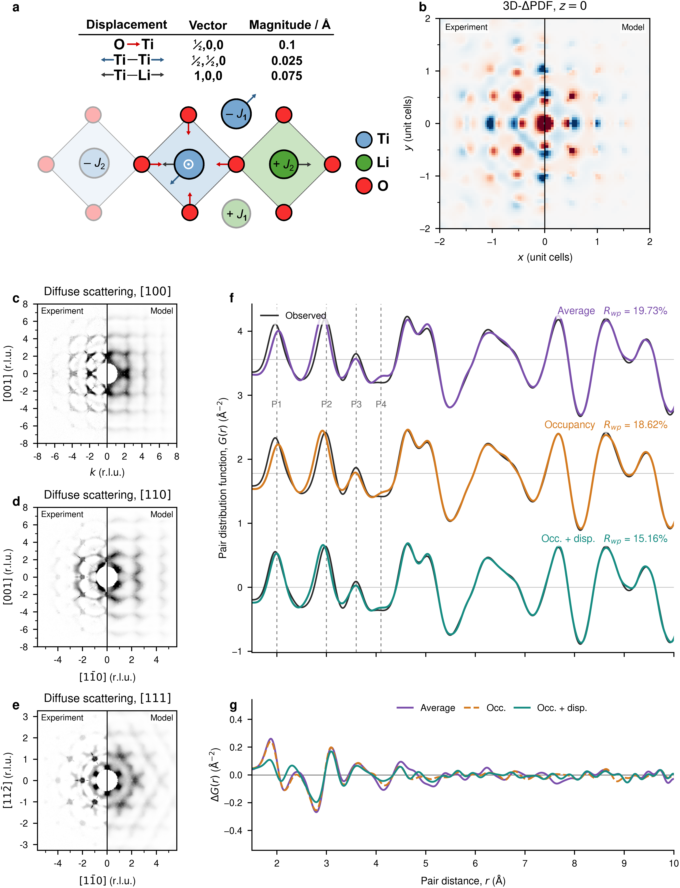

# Figure 2 — Model, scattering and PDF comparisons



Model schematic, experimental/model 3D-ΔPDF and [100], [110], [111] diffuse-scattering half-plane comparisons, and three 1D PDF fits with residuals. The model is Run 71 case 01 with Run 61_02 displacements.

Inputs include `model_schematic2.png`, all three PDF fit tables (average, occupational only, occupational plus displacement), the experimental ΔPDF and scattering HDF5 files with coordinates/attributes, the complete model ΔPDF volume and direct axis, and all rows of the four model scattering columns consumed by the original script.

The 336 MB scattering text input and model volume are encoded losslessly as compressed `.npz` arrays (scattering column keys `h`, `k`, `l`, `intensity`; volume key `volume`). Only their loaders and filename extensions were adapted; interpolation, half-plane assembly, origin punch, normalization, panel layout, and precision are preserved. The volume remains in its original dtype; scattering values are the same float64 values produced by the original `np.loadtxt`. `provenance.json` records hashes of both the original and bundled files.

## Reproduce

From the repository root, after installing `figures/requirements.txt`:

```bash
python figures/figure_2/plot.py
```

The script works from any current directory. It writes `model_pdf_71_01_combined.png`, `.pdf`, and `.svg` into `figure_2/output/`. PNG export uses 600 dpi. `reference/` contains exact copies of the article artwork supplied by the author. Generated output is kept separate from these references.

`source/` contains the plotting scripts, helper modules, and data in their original relative directory layout. `provenance.json` maps every bundled source/data/reference file to its original path and SHA-256 checksum. Original metadata preserves the historical absolute paths; regeneration resolves only the bundled paths. Fonts can change text metrics if the original font is unavailable.
