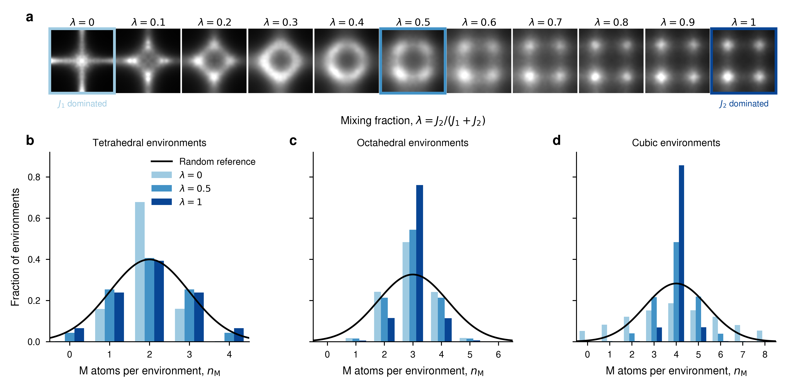

# Figure 3 — Interaction mixing sweep



Eleven [100] scattering surfaces for λ = 0, 0.1, …, 1 at J1 + J2 = 0.2 eV and 1000 K, with tetrahedral, octahedral and cubic environment distributions at λ = 0, 0.5, 1.

Inputs include all eleven original `*_100vox_sc_list.txt` surface files and the local-environment count CSV. The original sweep subdirectories are retained so the script resolves each λ unambiguously. The plot selects h = 0 and 0 ≤ k,l ≤ 2, yielding 101 × 101 panels, each independently normalized at the 99.5th percentile.

The black reference curves use the original normal approximation to the fixed-composition random fractions stored in the CSV. The source workflow calls the transition-metal species Fe; the figure labels it M.

## Reproduce

From the repository root, after installing `figures/requirements.txt`:

```bash
python figures/figure_3/plot.py
```

The script works from any current directory. It writes `mixing_sweep_0p2eV_100_plane.png`, `.pdf`, and `.svg` into `figure_3/output/`. PNG export uses 600 dpi. `reference/` contains exact copies of the article artwork supplied by the author. Generated output is kept separate from these references.

`source/` contains the plotting scripts, helper modules, and data in their original relative directory layout. `provenance.json` maps every bundled source/data/reference file to its original path and SHA-256 checksum. Original metadata preserves the historical absolute paths; regeneration resolves only the bundled paths. Fonts can change text metrics if the original font is unavailable.
