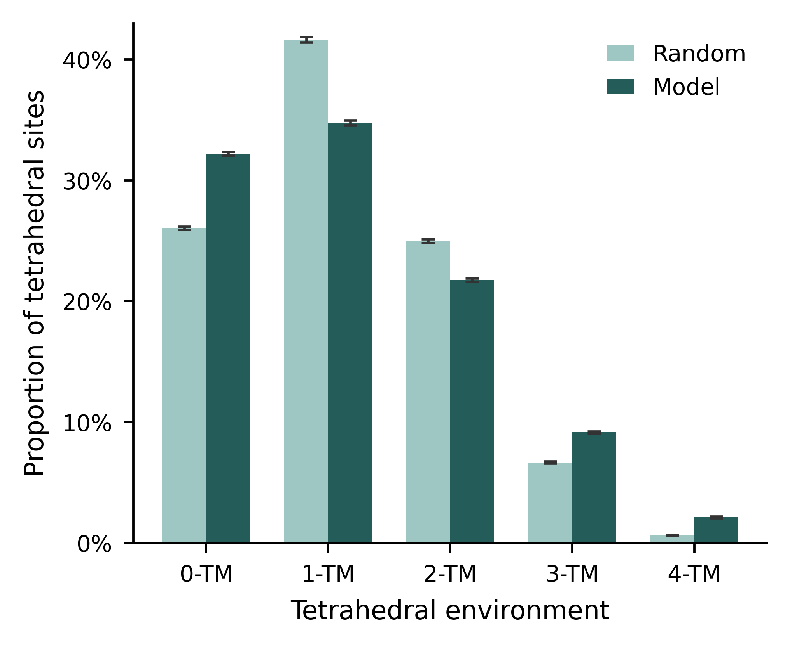

# Figure 4 — 0-TM ensemble populations



Standalone population panel without a panel letter, comparing random controls and the Run-71 occupational model using the Run-81 ensemble: 100 model configurations and 100 random controls.

The complete `ensemble_summary.csv` is the plotting input. The original plotting helper reads `tm0_fraction` through `tm4_fraction` for `random` and `run71_mc`; bar heights are ensemble means and error bars are sample standard deviations across configurations. The original population export and ensemble caption are also included for provenance. The absolute summary path was replaced with a bundle-relative path.

The plotted statistics are already calculated in the summary CSV; reproducing the plot does not require rerunning Monte Carlo or connectivity analysis.

## Reproduce

From the repository root, after installing `figures/requirements.txt`:

```bash
python figures/figure_4/plot.py
```

The script works from any current directory. It writes `run81_0tm_natcommun_ensemble_panel_a_no_label.png`, `.pdf`, and `.svg` into `figure_4/output/`. PNG export uses 600 dpi. `reference/` contains exact copies of the article artwork supplied by the author. Generated output is kept separate from these references.

`source/` contains the plotting scripts, helper modules, and data in their original relative directory layout. `provenance.json` maps every bundled source/data/reference file to its original path and SHA-256 checksum. Original metadata preserves the historical absolute paths; regeneration resolves only the bundled paths. Fonts can change text metrics if the original font is unavailable.
